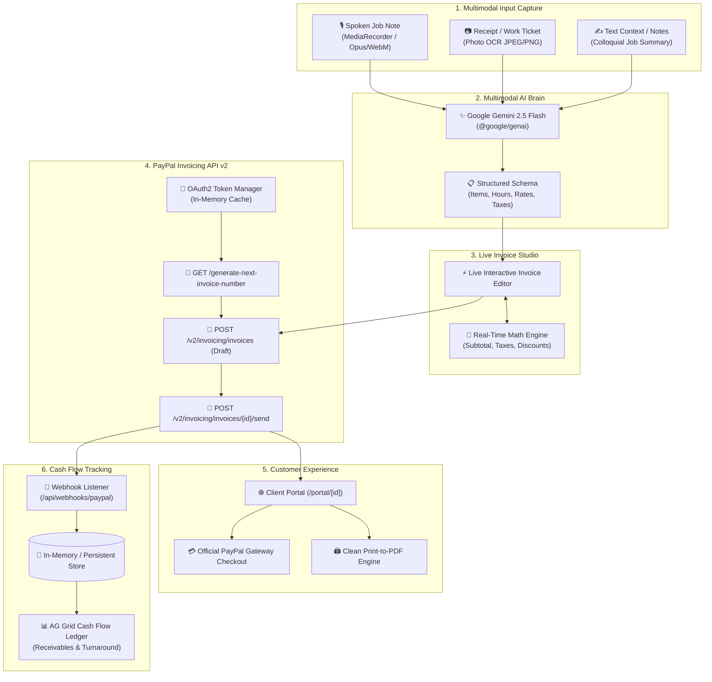

# VoiceToInvoice 🎙️ 🧾 💳
### Multimodal AI Invoicing & Cash Flow Copilot for Freelancers, Contractors & SMBs

[-black?style=flat&logo=next.js)](https://nextjs.org/)
[](https://ai.google.dev/)
[](https://developer.paypal.com/docs/api/invoicing/v2/)
[](https://www.ag-grid.com/)
[](https://render.com/)
[](LICENSE)

---

## 🚀 Overview

Contractors, technicians, and freelancers lose an average of **12 to 18 hours per month** manually typing invoices from crumpled hardware receipts, messy job tickets, or fragmented audio notes. Worse, delayed invoices directly crush cash flow.

**VoiceToInvoice** solves this end-to-end:
1. **Multimodal Voice & Vision Ingestion**: Speak a casual voice note from your truck or snap a photo of a store receipt/handwritten ticket.
2. **Gemini 2.5 Multimodal Extraction Engine**: Intelligently parses colloquial contractor speech (*"Billed four and a half hours at eighty bucks an hour plus sixty dollars for parts"*), OCRs noisy store receipts, and maps everything to structured invoice schemas with automated sales tax and discount calculations.
3. **Interactive Live Invoice Studio**: A side-by-side live document editor that recalculates line items, taxes, discounts, and totals in real time.
4. **PayPal Invoicing API v2 Dispatch**: Generates official sequential invoice numbers (`generate-next-invoice-number`), builds draft invoices, and dispatches official PayPal payment requests with sandbox payment links in 1 click.
5. **Real-time Cash Flow Ledger & Automated Cadences**: Powered by **AG Grid React**, tracking receivables, pending revenue, average turnaround times, and automated reminder notifications.
6. **Customer Portal & Print-to-PDF**: Dedicated buyer-facing portal with direct PayPal gateway checkout and print-optimized PDF styling.

---

## 🏛️ System Architecture



---

## 🛠️ Tech Stack & Key Libraries

- **Framework**: [Next.js 14+](https://nextjs.org/) (App Router, React 18, TypeScript)
- **Styling**: [Tailwind CSS](https://tailwindcss.com/) with responsive mobile and `@media print` PDF stylesheet
- **AI / Multimodal**: [`@google/genai`](https://www.npmjs.com/package/@google/genai) (Gemini 2.5 Flash Structured JSON Schema)
- **Payment & Invoicing**: [PayPal Invoicing API v2](https://developer.paypal.com/docs/api/invoicing/v2/) & OAuth2 Bearer Caching
- **Data Grid & Ledger**: [`ag-grid-react`](https://www.ag-grid.com/react-data-grid/) & `ag-grid-community` v32
- **Audio Processing**: HTML5 `MediaRecorder` API + Web Audio API `AudioContext` Frequency Analyser
- **Icons**: [`lucide-react`](https://lucide.dev/)
- **Deployment**: [Render](https://render.com/) via `render.yaml` and multi-stage `Dockerfile`

---

## ⚡ Quick Start & Setup Guide

### 1. Prerequisites
- Node.js 18+ (tested on Node 20 & Node 24)
- npm or yarn

### 2. Clone and Install
```bash
git clone https://github.com/Ayush-web28/VoiceToInvoice.git
cd VoiceToInvoice
npm install
```

### 3. Configure Environment Variables
Copy `.env.example` to `.env.local`:
```bash
cp .env.example .env.local
```

Populate the keys:
```ini
# PayPal Developer Sandbox (https://developer.paypal.com/dashboard/applications/sandbox)
PAYPAL_CLIENT_ID=your_sandbox_client_id
PAYPAL_CLIENT_SECRET=your_sandbox_client_secret
PAYPAL_API_BASE=https://api-m.sandbox.paypal.com
PAYPAL_WEBHOOK_ID=your_optional_webhook_id

# Google Gemini API (https://aistudio.google.com/app/apikey)
GEMINI_API_KEY=your_gemini_api_key

# Public App URL
NEXT_PUBLIC_APP_URL=http://localhost:3000
```

> **Note on Zero-Config Sandbox Mode**:
> If you run the app without credentials, VoiceToInvoice automatically enables **Zero-Config Sandbox Simulation Mode**, generating realistic invoice numbers, mock PayPal payment URLs, and instant test webhook events so you can test all workflows immediately!

### 4. Run the Development Server
```bash
npm run dev
```
Open [http://localhost:3000](http://localhost:3000) in your browser.

---

## 🧪 Testing the 4 Main Workflows

### 1. Voice Note Recording Workflow
1. Navigate to **Invoice Studio** (`/invoicing`).
2. Click the red **Record** microphone button and say:
   > *"Met with client Sarah Jenkins at 742 Evergreen Terrace. Worked four and a half hours doing pipe fitting and boiler repair at eighty bucks an hour. Replaced the pressure valve for sixty dollars. Due in two weeks."*
3. Click **Stop**, then click **Transcribe & Extract with Gemini 2.5**.
4. Watch Gemini 2.5 immediately populate:
   - Line Item 1: `Labor - Diagnostic & Repairs` (Qty: 4.5, Rate: $80.00)
   - Line Item 2: `Replacement Parts & Fittings` (Qty: 1, Rate: $60.00)
   - Customer: `Sarah Jenkins` (`sjenkins.home@gmail.com`)
   - Due Date: Exactly 14 days out

### 2. Receipt OCR Vision Workflow
1. In Invoice Studio, select the **Receipt OCR** tab.
2. Upload any store receipt, hardware ticket, or handwritten work order.
3. Click **Extract Receipt Line Items & Taxes**.
4. Gemini 2.5 Vision cleans up the OCR noise, identifies individual items, breaks out sales tax from the subtotal, and updates the invoice editor.

### 3. PayPal Invoicing API v2 Dispatch
1. Review or edit any quantities, rates, customer names, or terms in the Live Document Editor.
2. Click **Dispatch via PayPal Invoicing API**.
3. The server generates a sequential invoice number via `POST /v2/invoicing/generate-next-invoice-number`, creates the draft via `POST /v2/invoicing/invoices`, dispatches it with `POST /v2/invoicing/invoices/{id}/send`, and displays the public PayPal payer portal link.

### 4. Cash Flow Ledger & Automated Cadences
1. Navigate to **Cash Flow Ledger** (`/invoices`).
2. Interact with the **AG Grid** table:
   - Sort by Amount, Due Date, or Status.
   - Use the real-time search box to filter by client name or invoice number.
   - Click **Remind** to trigger an automated payment reminder cadence.
   - Click **Portal** to view the customer-facing invoice or print to PDF.

---

## 📡 API Endpoints Reference

| Endpoint | Method | Description |
|---|---|---|
| `/api/paypal/health` | `GET` | Verifies PayPal Sandbox credentials and next invoice number generation |
| `/api/invoice/voice` | `POST` | Accepts multipart audio (`.webm`, `.mp3`, `.wav`) -> Gemini 2.5 extraction |
| `/api/invoice/vision` | `POST` | Accepts multipart image (`.jpg`, `.png`, `.webp`) -> Gemini 2.5 Vision OCR |
| `/api/invoice/text` | `POST` | Accepts JSON `{ prompt }` -> Gemini 2.5 structured extraction |
| `/api/invoice/send` | `POST` | Validates invoice, creates draft, and dispatches via PayPal Invoicing API v2 |
| `/api/invoice/[id]` | `GET`, `DELETE` | Retrieves or cancels an invoice |
| `/api/invoices` | `GET` | Fetches all ledger invoices, receivables metrics, and turnaround stats |
| `/api/webhooks/paypal`| `POST` | Handles `INVOICING.INVOICE.PAID`, `CANCELLED`, `REFUNDED` webhooks |

---

## 🌐 Zero-Config Render Deployment

This repository includes a native [`render.yaml`](./render.yaml) blueprint and production [`Dockerfile`](./Dockerfile).

1. Push your code to GitHub.
2. In the [Render Dashboard](https://dashboard.render.com/), click **New +** -> **Blueprint**.
3. Connect `https://github.com/Ayush-web28/VoiceToInvoice`.
4. Render will automatically detect `render.yaml`, configure the Node web service, and provision your production URL.

---

## 📄 License
This project is open-source and licensed under the [MIT License](LICENSE).
